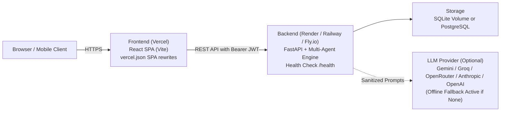

# SkillPath – Deployment & Hosting Guide

This guide covers deploying SkillPath in production:
- **Frontend (React + Vite + Tailwind CSS):** Deployed to [Vercel](https://vercel.com)
- **Backend (FastAPI + SQLite/PostgreSQL + Multi-Agent Engine):** Deployed to [Render](https://render.com), [Railway](https://railway.app), or [Fly.io](https://fly.io)

---

## Architecture Overview



---

## Part 1: Frontend Deployment on Vercel

### Step 1: Connect Your Repository
1. Log in to your [Vercel Dashboard](https://vercel.com/dashboard) and click **Add New...** → **Project**.
2. Import your GitHub repository (`SkillPath`).

### Step 2: Configure Project Settings
- **Root Directory:** Click `Edit` and select `frontend`.
- **Framework Preset:** `Vite` (automatically detected).
- **Build Command:** `npm run build`
- **Output Directory:** `dist`
- **Install Command:** `npm install`

### Step 3: Environment Variables
Add the following environment variable in the Vercel project configuration:

| Variable Name | Value | Description |
|---|---|---|
| `VITE_API_URL` | `https://your-backend.onrender.com` | Base URL of your deployed backend API (omit trailing slash). |

### Step 4: SPA Routing (`vercel.json`)
SkillPath includes a `frontend/vercel.json` file to ensure client-side routing works seamlessly across all paths (`/onboarding`, `/discovery`, `/roadmap`, `/passport/:slug`, etc.):

```json
{
  "rewrites": [
    {
      "source": "/(.*)",
      "destination": "/index.html"
    }
  ]
}
```

Click **Deploy**. Your frontend will be live at `https://<your-project>.vercel.app`.

---

## Part 2: Backend Deployment

You can deploy the backend using any of the following platforms. The backend includes a pre-configured `Dockerfile` with automatic database seeding and health checking at `/health`.

---

### Option A: Render (Recommended for Simplicity)

1. Go to [Render Dashboard](https://dashboard.render.com/) and click **New +** → **Web Service**.
2. Connect your GitHub repository.
3. Configure settings:
   - **Name:** `skillpath-backend`
   - **Environment:** `Docker` (or `Python 3`)
   - **Branch:** `main`
   - **Root Directory:** Leave blank (repository root) or specify `.`
   - **Dockerfile Path:** `./Dockerfile`
   - **Plan:** Free or Starter
4. Add **Environment Variables**:
   ```ini
   PYTHONPATH=/app
   PORT=8000
   SECRET_KEY=generate_a_random_32_character_string_here
   ALLOWED_ORIGINS=https://your-frontend.vercel.app,http://localhost:5173
   LLM_PROVIDER=gemini
   GEMINI_API_KEY=your_gemini_api_key_here  # Optional: app uses rule-based fallback if unset
   ```
5. Set Health Check Path:
   - **Health Check Path:** `/health`
6. Click **Create Web Service**. Render will build the Docker container, run seed scripts automatically, and serve on `https://<your-backend>.onrender.com`.

---

### Option B: Railway

1. Go to [Railway.app](https://railway.app/) and create a new project.
2. Select **Deploy from GitHub repo** and pick the `SkillPath` repository.
3. In **Settings** → **Build**:
   - **Builder:** `Dockerfile` (using root `Dockerfile`)
4. Add **Variables**:
   - `SECRET_KEY`: `<your-random-jwt-secret>`
   - `ALLOWED_ORIGINS`: `https://your-frontend.vercel.app`
   - `LLM_PROVIDER`: `gemini` (or `groq`, `openrouter`, etc.)
   - `GEMINI_API_KEY`: `<your-key-if-available>`
5. *(Optional)* Add a **Persistent Volume** mounted at `/app/backend` if you want SQLite database changes to persist across redeployments, or provision a Railway PostgreSQL database and set `DATABASE_URL`.
6. Railway automatically exposes your service on an assigned domain.

---

### Option C: Fly.io

1. Install the Fly CLI and log in:
   ```bash
   brew install flyctl
   fly auth login
   ```
2. Initialize app in repository root:
   ```bash
   fly launch --no-deploy
   ```
3. Set your secrets:
   ```bash
   fly secrets set \
     SECRET_KEY="your-production-jwt-secret" \
     ALLOWED_ORIGINS="https://your-frontend.vercel.app" \
     LLM_PROVIDER="gemini" \
     GEMINI_API_KEY="your_optional_gemini_key"
   ```
4. Allocate a persistent volume for the SQLite database:
   ```bash
   fly volumes create skillpath_data --size 1
   ```
5. Deploy:
   ```bash
   fly deploy
   ```

---

## Part 3: Production Verification Checklist

After deploying both frontend and backend:

- [ ] **Health Check:** Open `https://your-backend.onrender.com/health` in your browser. Verify it returns:
  ```json
  {
    "status": "healthy",
    "app": "SkillPath",
    "database": "connected",
    "version": "1.0.0",
    "llm_provider": "gemini",
    "llm_connected": true
  }
  ```
- [ ] **CORS Verification:** Ensure `ALLOWED_ORIGINS` in your backend contains your exact Vercel URL (e.g. `https://skillpath.vercel.app`). No wildcard `*` should be used in production.
- [ ] **1-Click Welcome Screen:** Visit your Vercel URL. Click **"Start My Career Journey"** to verify anonymous guest learner JWT creation and onboarding flow.
- [ ] **Seeded Personas:** Click **"Explore as Arif"**, **"Priya Sharma"**, or **"Admin Dashboard"** to verify 1-click passwordless evaluation without errors.
- [ ] **Offline Fallback:** If no AI key is configured (`GEMINI_API_KEY=""`), test that Mentor, Flight Simulator, and Career Matcher work reliably with seeded database intelligence.

