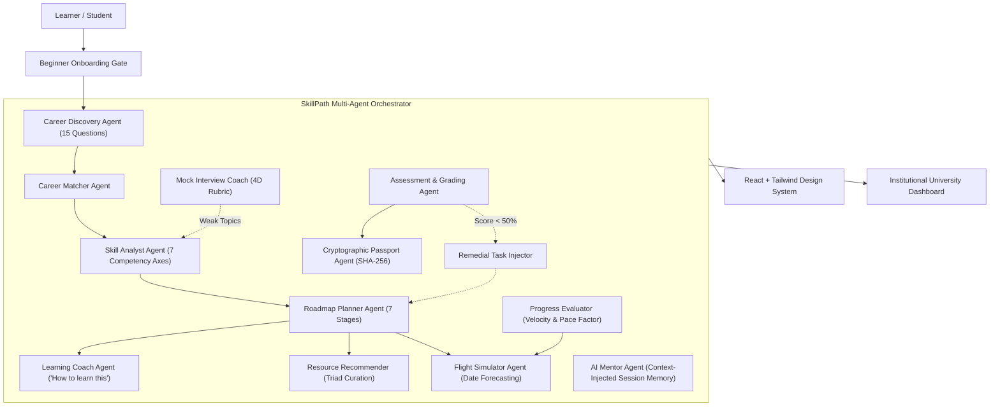
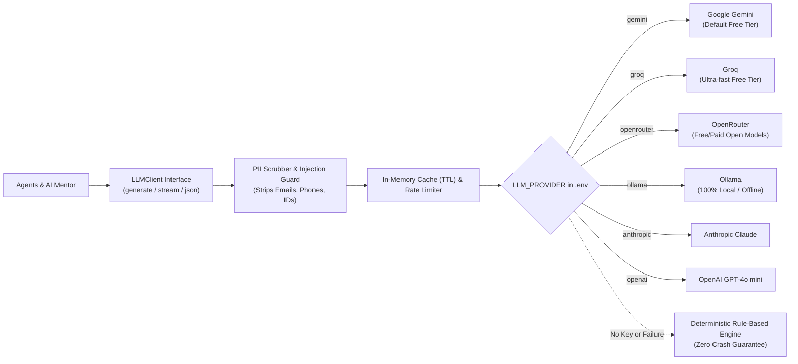

# SkillPath – Your Career Path, From Zero to Job-Ready

> **SkillPath** is an AI-powered, beginner-first career development platform built specifically for students and early-career learners who have little or no idea what career to choose. A student who joins knowing nothing leaves their first session understanding **which careers fit them, what skills to learn, how to learn each skill, where to start this week, and their complete roadmap to becoming job-ready**.

---

## 🌟 Core Mission & Beginner-First Philosophy

Most career guidance and learning platforms assume the learner already knows what they want (e.g. *"Enter your goal: Senior React Developer"*), understand industry jargon (*"tech stacks", "CI/CD", "frameworks"*), or have existing projects.

**SkillPath reverses this:**
1. **Never assumes prior knowledge**: Terms are written at a Grade-8 reading level, and every technical term has an interactive plain-language tooltip.
2. **"I'm not sure yet" is a first-class citizen**: A dedicated 15-question discovery engine maps everyday interests, strengths, and college subjects to high-demand careers.
3. **"None yet" is always valid**: Learners are never blocked if they have no skills, projects, or certifications.
4. **"How to learn this" for every single skill**: Explains what it is, why it matters, time estimates, learning methods (e.g. 30% watch, 70% build), common mistakes, and exact done criteria.
5. **Deterministic offline fallback**: All multi-agent decisions, roadmaps, flight simulator projections, and passport verifications run 100% offline without requiring external API keys.

---

## 🏗️ System Architecture & Multi-Agent Engine

SkillPath features 13 specialized AI agents orchestrated under a **LangGraph state pattern**, backed by FastAPI, SQLite/PostgreSQL, and React:



### The 13 Specialized Agents

1. **Discovery Agent**: 15-question interest, subject, and puzzle evaluator with degree/branch bonus weighting.
2. **Career Matcher Agent**: Exact weighted skill overlap formula ($\sum \min(\text{cur}, \text{target}) \times w / \sum \text{target} \times w$).
3. **Skill Analyst Agent**: Evaluates strengths, weaknesses, and 7-axis competency radar.
4. **Learning Coach Agent**: Creates "How to learn this" breakdown cards and "Your First Week" 30–60 min daily tasks.
5. **Resource Recommender Agent**: Curates beginner-friendly video, interactive tutorial, practice, and project resources.
6. **Roadmap Planner Agent**: Builds a 7-stage zero-to-job roadmap with year-of-study timeline adjustments.
7. **Assessment Agent**: Evaluates 5-MCQ checkpoint quizzes and code tasks; handles $\ge 70\%$ verified promotions and $< 50\%$ remedial loops.
8. **Progress Evaluator Agent**: Tracks student velocity and dynamically recalculates the `learner_pace_factor`.
9. **Simulation Agent (Flight Simulator)**: Calculates job-readiness dates with what-if schedule and career comparisons.
10. **Interview Coach Agent**: Simulates 5–8 gap-targeted interview questions with 4-dimensional rubric grading (1–5) and sample answers.
11. **Profile Agent**: Resilient resume text analyzer with prompt-injection sanitization.
12. **Career Guide Agent**: Generates end-to-end customized career guide books with 12-month milestones.
13. **AI Mentor Agent**: Friendly conversational guide with context memory and quick prompt chips.

---

## 🔌 Provider-Agnostic LLM Layer (`LLMClient`)

SkillPath features an enterprise-grade, provider-agnostic LLM interface. All agents, mentors, and parsers interact **exclusively** with `LLMClient`—never coupling directly to a proprietary vendor SDK.



### Switching Providers via `.env`

To switch LLM providers, set `LLM_PROVIDER` in your `.env` file:

```bash
# Available options: gemini | groq | openrouter | ollama | anthropic | openai
LLM_PROVIDER=gemini
```

### Free Keys & Supported Providers

| Provider | `LLM_PROVIDER` | Default Model | Free Tier & Setup Details |
| :--- | :--- | :--- | :--- |
| **Google Gemini** | `gemini` | `gemini-1.5-flash` | **Free Tier (Default)**: 15 Requests/Min, 1M Tokens/Min.<br>Get key: [Google AI Studio](https://aistudio.google.com/) |
| **Groq** | `groq` | `llama-3.3-70b-versatile` | **Free Tier**: 30 Requests/Min, ultra-fast inference.<br>Get key: [Groq Console](https://console.groq.com/) |
| **OpenRouter** | `openrouter` | `meta-llama/llama-3.3-70b-instruct:free` | **Free Tier**: Free open-weights models available.<br>Get key: [OpenRouter](https://openrouter.ai/) |
| **Ollama** | `ollama` | `llama3` | **100% Free & Local**: No API key required.<br>Run: `ollama run llama3` |
| **Anthropic** | `anthropic` | `claude-3-5-haiku-20241022` | Paid API tier: [Anthropic Console](https://console.anthropic.com/) |
| **OpenAI** | `openai` | `gpt-4o-mini` | Paid API tier: [OpenAI Platform](https://platform.openai.com/) |

### Built-in Resilience & Safety Guarantees

1. **Deterministic Database Fallback**:
   If no API key is provided, or if the external LLM provider experiences network downtime, SkillPath automatically activates curated rule-based answers built from the SQLite/PostgreSQL database. The career discovery results, 7-stage roadmap, flight simulator forecast, and cryptographic passport **always work 100% offline without any AI key**.
2. **Personal Identifier Stripping**:
   Before prompts leave the backend boundary to external third-party LLMs, `strip_personal_identifiers()` strips all emails (`[EMAIL]`), phone numbers (`[PHONE]`), and student/national ID numbers (`[ID]`).
3. **Exponential Backoff & Retries**:
   Transient HTTP `429` (Too Many Requests), `503`, and network timeouts are automatically retried with exponential backoff ($0.5s \times 1.5^{\text{attempt}}$).
4. **Per-User Rate Limiting & Response Caching**:
   Requests are cached in-memory with SHA-256 prompt hash keys to prevent duplicate billing and minimize latency. A sliding-window limiter prevents single-user quota exhaustion.
5. **Visible Busy Notice**:
   When rate limits are approached, the UI displays a clear notice: *"AI is busy, try again shortly"*, falling back smoothly to offline guidance.

---

## 🎨 Design System & Color Tokens

SkillPath uses a clean, editorial **Light Theme Only** palette inspired by classic field notebooks and warm educational papers:

| Token | Hex Value | Purpose |
| :--- | :--- | :--- |
| **Background** (`bg`) | `#F7F6F2` | Warm linen paper background (no dark mode, light scheme only) |
| **Surface** (`surface`) | `#FFFFFF` | Clean white cards and elevated containers |
| **Ink** (`ink`) | `#1C2B2A` | Deep forest ink for readable headings and body text |
| **Ink Secondary** | `#5E6B69` | Subtitles, supporting copy, and metadata |
| **Ink Muted** | `#8A9694` | Borders, subtle helper labels, and timestamp text |
| **Primary** (`primary`) | `#0F6E68` | Deep Teal — main brand color, progress bars, active nav |
| **Primary Tint** | `#E3F1EF` | Soft teal badges, active pill backgrounds |
| **Accent** (`accent`) | `#E8A33D` | Warm Saffron — milestone highlights, try-it mini tasks |
| **Accent Tint** | `#FDF3E3` | Warm amber warning badges and focus indicators |
| **Success** | `#2F8F5B` | Verified skill badges, passed checkpoints |
| **Danger** | `#C8463D` | Failed tests, critical gap warnings |

**Typography**:
- Headings: `Fraunces` / `DM Serif Display` (Warm, human, encouraging editorial serif)
- Body: `Plus Jakarta Sans` / `Inter` (Crisp, high-legibility geometric sans-serif)

---

## 📐 Mathematical Formulas

### 1. Weighted Career Match
$$\text{Match Percentage} = \frac{\sum_{i=1}^{N} \min(\text{CurrentLevel}_i, \text{TargetLevel}_i) \times \text{Weight}_i}{\sum_{i=1}^{N} \text{TargetLevel}_i \times \text{Weight}_i} \times 100\%$$

### 2. Career Flight Simulator
$$\text{Hours Needed}_i = (\text{TargetLevel}_i - \text{CurrentLevel}_i) \times \text{BaseHours}_i \times \text{Difficulty}_i \times \text{LearnerPaceFactor}$$
$$\text{Weeks to Job Ready} = \frac{\sum \text{Hours Needed}_i}{\text{WeeklyStudyHours}}$$

- $\text{LearnerPaceFactor}$ starts at $1.0$.
- Recalculates dynamically based on assessment scores and task completion velocity (e.g. $0.85$ for fast learners, $1.20$ for thorough pacing).

### 3. Cryptographic Tamper-Evident Passport Hash
$$\text{Hash} = \text{SHA-256}(\text{UserID} \,\|\, \text{SkillSlug} \,\|\, \text{ScoreFormatted} \,\|\, \text{DateISO} \,\|\, \text{SecretSalt})$$

- Recalculated live on the public verification page `/passport/:slug`. If a user tampers with the score, date, or skill, verification immediately fails.

---

## 👥 Pre-Seeded Demo Personas

SkillPath includes 5 realistic pre-seeded accounts configured for instant evaluation:

| User | Email / Password | Background | Starting Scenario |
| :--- | :--- | :--- | :--- |
| **Arif Mohamed** | `arif@skillpath.dev`<br>`arif123` | B.Tech AI & Data Science, 3rd Year | *"I don't know what to do after college"* → Discovers AI/ML Engineer & Data Analyst. |
| **Priya Sharma** | `priya@skillpath.dev`<br>`priya123` | 1st Year Engineering | Day Zero beginner with no skills → Starts from Foundations & Logic Puzzles. |
| **Rohan Patel** | `rohan@skillpath.dev`<br>`rohan123` | Self-taught coder | Known goal (Full Stack Developer) → Skips discovery directly to Gap Analysis. |
| **Ananya Sen** | `ananya@skillpath.dev`<br>`ananya123` | Working professional | Career switcher targeting Data Analyst. |
| **Admin** | `admin@skillpath.dev`<br>`admin123` | University Placement Head | Views cohort skill gaps, student readiness rosters, and placement benchmarks. |

---

## 🚀 Quickstart & Installation

### Option A: Local Development (Recommended)

#### 1. Setup Backend
```bash
# Create and activate virtual environment
python3 -m venv .venv
source .venv/bin/activate

# Install dependencies
pip install -r backend/requirements.txt

# Run migrations and seed data
PYTHONPATH=. python -m backend.app.seed.seed_runner

# Start FastAPI backend
PYTHONPATH=. uvicorn backend.app.main:app --port 8000 --reload
```
API Docs available at: **http://localhost:8000/docs**

#### 2. Setup Frontend
```bash
cd frontend
npm install
npm run dev
```
Web Application available at: **http://localhost:5173**

---

### Option B: Docker Compose

```bash
# Build and run backend and frontend containers
docker compose up --build -d

# Check running services
docker compose ps
```
- Frontend: **http://localhost:5173**
- Backend: **http://localhost:8000**

---

## 🧪 Automated Test Suite

SkillPath includes an automated Pytest test suite covering authentication, discovery algorithms, career matching, roadmap regeneration, flight simulator forecasting, cryptographic hashing, and multi-agent auditing:

```bash
# Run all tests with verbosity
PYTHONPATH=. .venv/bin/pytest backend/tests/ -v
```

Expected result:
```
======================= 23 passed in 1.14s ========================
```

---

## 🗺️ Zero-to-Job 7-Stage Roadmap

Every personalized roadmap follows a proven 7-stage career progression:
1. **Explore & Foundations**: Career discovery, computational thinking, and git setup.
2. **Core Foundations**: Language mastery (Python, SQL, JavaScript) and fundamental algorithms.
3. **Core Skills & Tools**: Industry toolchains (Docker, Pandas, APIs, React, Cloud).
4. **Projects & Portfolio**: Real-world mini projects, full-stack apps, and GitHub documentation.
5. **Internship & Experience**: Resume creation, application timing adjusted for 2nd/3rd/4th year, and open source contributions.
6. **Interview Prep & Placement**: 4D rubric mock interviews, behavioral prep, and coding assessments.
7. **Growth & Specialization**: Advanced certifications, cloud architect credentials, and higher studies (GATE/GRE).

---

## 📄 License
MIT License. Built with pride for students seeking direction and career clarity.

